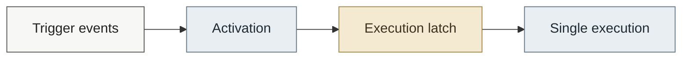

# Security model

This document describes the **security consequences, trust boundaries, guarantees and limitations** of the project's design.

It exists to prevent ambiguity, misuse and incorrect assumptions by users, auditors and contributors.

For architectural context, see [design philosophy](manifesto.md). For implementation details, see [development guide](development.md).

## Threat model

Wrong Boot is designed for systems where the operator has control of the machine before an incident occurs and wants a pre-configured response to remain available even when normal user-space mechanisms may no longer be reliable.

The model assumes:

* The operator can load and configure the kernel module before the relevant incident.
* The kernel is trusted at the time the module is loaded.
* The operator chose the payload on purpose.
* Trigger inputs (keyboard events, USB events and network traffic) may come from untrusted sources.
* User-space processes may become unavailable, compromised or too late to respond.
* The system may become physically or logically hostile after activation.

The model does **not** assume that Wrong Boot can remain secure against an attacker who already controls the kernel.

## Trust boundaries

### Kernel

The running kernel is the primary trust root for Wrong Boot.

The module relies on kernel facilities including:

* Kernel notifier mechanisms
* USB subsystem notifications
* Netfilter
* Kernel timers
* Workqueues
* User Mode Helper

If an attacker can arbitrarily modify or control the running kernel, the security properties described by this document can no longer be relied upon.

A kernel-level attacker can potentially:

* Unload or disable the module
* Modify the module's state
* Prevent trigger callbacks from executing
* Intercept or alter activation requests
* Modify the configured execution state
* Replace or interfere with the execution mechanism
* Observe or alter kernel-resident configuration

Wrong Boot therefore provides no meaningful protection against an _already-compromised_ kernel.

### User space

Wrong Boot does not depend on a user-space daemon to remain alive to observe trigger events.

Detection and activation happen at the kernel boundary. The configured action is then deliberately handed back to user space.

This creates an asymmetric boundary. The kernel is used to preserve the ability to **detect and authorize** the response, while the consequence of that response is intentionally delegated to the configured payload.

The activation latch and deferred execution path are implementation details covered in [development.md](development.md).

### External inputs

Keyboard activity, USB events and network traffic are treated as external inputs rather than trusted configuration.

A trigger should therefore only act on an input according to its configured matching rules.

An external event does not gain additional privileges merely by causing a trigger to activate.

## Privileges

Loading the module requires the privileges necessary to load a kernel module on the target system, typically including `CAP_SYS_MODULE` where module loading is permitted.

This requirement is intentional.

Wrong Boot is not a privilege-escalation mechanism. It assumes the operator already has sufficient control of the system to install and configure kernel code.

The loaded module runs in kernel context and starts the payload through the kernel's User Mode Helper. The payload runs as root with kernel credentials and the full capability set (the `kernel.usermodehelper.bset` sysctl can narrow it). No user session restricts it.

Treat the payload as a **high-privilege operation**. Keep the file, its interpreter and everything it calls writable by root only.

## Kernel/user-space execution boundary

Trigger detection occurs at the kernel boundary. The core decides whether execution proceeds when a trigger condition holds and defers the payload out of the trigger context.

The action is then handed back to user space through the kernel's User Mode Helper mechanism.

This creates an intentional asymmetry:

* Detection and activation are handled by the kernel.
* The configured consequence is executed in user space.

The configured action therefore inherits the privileges and execution environment of the User Mode Helper path and should be treated as a high-privilege operation.

## One-shot execution guarantee

All triggers converge on a single execution latch. At most one activation can consume it even when multiple triggers activate concurrently. The latch is armed only after every trigger has initialized. A load that fails never runs the payload.

The result is an **at-most-once execution guarantee**, not a guarantee that every trigger condition will be observed.

The activation latch and deferred execution mechanics are described in [development](development.md).

## Payload lifetime

A started payload is detached from the module. The core waits only until the payload has started (`UMH_WAIT_EXEC`) and never collects its exit status.

* Unloading the module neither waits for a running payload nor stops it.
* An attempt that has not started yet (a pending retry) is dropped on unload and logged.
* A payload that failed after starting is never run again.

Removing the module is therefore no way to stop a payload that already runs. Stop the process itself. Test how your payload behaves before you rely on it in an incident.

## Interception position

Wrong Boot observes trigger events through kernel mechanisms rather than relying on a persistent user-space process to report them.

This means stopping or modifying the user-space application that would normally consume an event does not necessarily prevent the kernel trigger from observing it.

The exact visibility and ordering of an event depend on the subsystem and hook used by the trigger. A kernel-level attacker remains outside the protection model.

## Secrets and their exposure

The phrase, the USB rules, the network values and the payload path are secrets. Wrong Boot keeps them in as few places as it can:

* **The parameter file** `/etc/wrong8007/wrong8007.conf` is readable by root only (mode `0600` in a `0700` directory).
* **Not in the boot image.** The file stays out of `/etc/modprobe.d`. Initramfs tools copy that directory into the usually unencrypted `/boot`. `make params-check` refuses `wrong8007` options there.
* **Not on a command line.** `make load-installed` hands the file to `modprobe`. Only the development target `make load` passes values to `insmod`, where the process list briefly shows them.
* **Not in sysfs.** The parameters are registered without sysfs entries and `/sys/module/wrong8007/parameters/` does not list them.
* **Not in the source tree or the module.** Nothing secret is compiled into `wrong8007.ko`.
* **Not in the kernel log.** The phrase and the payload string never appear in it. A USB rule or MAC address that fails to parse is echoed in the load error so you can find the mistake.

The values still exist in plain text in that file and in kernel memory while the module is loaded. Root, anything with kernel read access and anyone holding the unencrypted disk can read them.

> **Parameter values are hidden from other users and readable by root and the kernel.**

## Payload security

The project deliberately does not prescribe what the configured action should do.

A payload may record information, notify another system, isolate the machine, start recovery, modify system state, destroy information or perform another operator-defined action.

The module therefore cannot guarantee that a payload is safe.

The payload inherits the privileges and execution context of the User Mode Helper path and may have consequences far beyond the trigger itself.

In particular, a malicious, accidental or poorly tested command can cause significant system impact.

## Guarantees and limitations

Wrong Boot provides architectural guarantees. Its behavior still depends on the kernel, the surrounding system and the configured payload.

### Architectural guarantees

The design provides:

* Centralized activation arbitration
* At-most-once start of the payload per load
* Separation between trigger detection and execution
* Fail-closed initialization that never runs the payload
* Deferred execution from trigger contexts
* A bounded retry window for a payload that fails to start

### Environment-dependent behavior

The following remain dependent on the surrounding system:

* Successful trigger observation
* Availability of the required kernel subsystems
* Successful module loading
* User-space process creation
* Availability of the payload, its interpreter and the tools it calls
* Completion of the configured payload

### Outside the model

Wrong Boot does not protect against:

* A compromised or untrusted kernel
* Failure to load the module before an incident
* Incorrect trigger or payload configuration
* Runtime failure of the underlying trigger subsystem
* Failure or unintended behavior of the configured payload
* Physical loss, destruction or power-off of the machine
* Disclosure of parameter values to root or to the kernel

Any general system-security failures outside the module's scope.

## Non-goals

Wrong Boot is not intended to:

* Escalate privileges
* Install itself without operator action
* Conceal its presence from the system owner
* Provide persistence against deliberate removal
* Defeat a trusted or compromised kernel
* Act as a general security-monitoring framework
* Guarantee that an arbitrary payload is safe
* Modify kernel memory outside its own scope

If you are looking for covert channels or evasion techniques, this project is **not for you**.

## Operational and ethical boundary

Wrong Boot is intended for systems the operator owns or is authorized to control.

The module provides a mechanism for pre-configured detection and response. The operator remains responsible for:

* Choosing appropriate trigger conditions
* Protecting access to the module and its configuration
* Testing the configured payload
* Understanding its consequences
* Complying with applicable laws, policies and organizational controls

The authors make **no claim** that this tool is suitable for offensive, covert or unauthorized use. Using it to damage systems you do not own or have no permission to modify is illegal.
